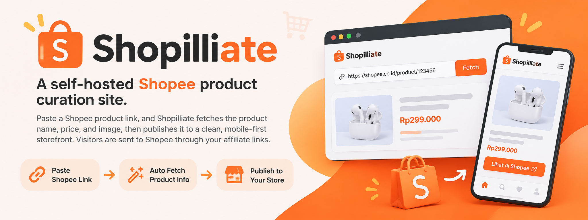

# Shopilliate

A self-hosted Shopee product curation site. Paste a Shopee product link, and Shopilliate fetches the product name, price, and image, then publishes it to a clean, mobile-first storefront. Visitors are sent to Shopee through your affiliate links.

Everything runs on a single Cloudflare Worker: the API (`/api/*`), images (`/img/*`), and the React single-page app.

[Bahasa Indonesia](docs/id-ID.md)

**Live demo:** [linkby.lukmanbagus.com](https://linkby.lukmanbagus.com) — an example site built with Shopilliate.

## Features

- Add products by pasting a Shopee link. Data is fetched through the official Shopee Affiliate API when configured, with a public-page fallback and a manual form as the last resort.
- Public storefront with categories, subcategories, search, sorting, TOP badges, and click tracking.
- Admin panel with a dashboard, product and category management, resync, image uploads, and site settings.
- Images are stored in Cloudflare R2 and served from your own domain.
- First-run setup wizard with atomic admin account creation and an optional `SETUP_TOKEN`.
- English by default, with Bahasa Indonesia available in Settings.
- One-color theming: pick a single accent color and the supporting shades are generated automatically.
- Admin-only display currency formatting, with no conversion or exchange rates.
- Self-contained schema creation: no manual database migrations.

## Tech stack

- Cloudflare Workers + Hono (TypeScript)
- Cloudflare D1 (SQLite)
- Cloudflare R2 object storage
- React + Vite + Tailwind CSS + React Router
- Zod for shared validation
- PBKDF2-SHA256 password hashing (100,000 iterations)

## Requirements

- A Cloudflare account (the free plan is enough for small sites).
- Node.js 20.19+ and npm for the one-command setup and local development.

## Deploy

### Option 1 — Deploy to Cloudflare button (recommended)

Replace `USERNAME` with your GitHub username:

```md
[](https://deploy.workers.cloudflare.com/?url=https://github.com/USERNAME/shopilliate)
```

1. Click the button and sign in to Cloudflare.
2. Cloudflare copies the repository to your GitHub/GitLab account and shows a deployment form.
3. Keep the build command `npm run build`. Optionally enter a `SETUP_TOKEN` secret to lock the setup page.
4. Deploy. The Worker, D1 database, and R2 bucket are provisioned and bound automatically.
5. Open the Worker URL right away and complete the `/setup` page.

> `wrangler.jsonc` intentionally omits resource IDs so Cloudflare can provision D1 and R2 for your account.

### Option 2 — One-command setup

```bash
npm install
npm run setup
```

The setup is interactive. It first asks how to prepare Cloudflare resources:

- **Create new resources** — creates the D1 database `shopilliate-db` and the R2 bucket `shopilliate-images` if they do not exist.
- **Use an existing deployment** — lists the D1 databases and R2 buckets already in your account, lets you pick them, and asks for the Worker name so the deploy updates the existing Worker.

In both cases it then writes the resource names and database ID into `wrangler.jsonc`, builds the frontend, deploys the Worker, and prints the deployed URL.

If your Cloudflare login has access to multiple accounts, the script lists them and asks which account to use. Every Wrangler command then runs with that account explicitly, so listing and creating resources always target the same account.

For non-interactive automation:

```bash
npm run setup -- --new --account <account-id>
npm run setup -- --existing --account <account-id> --d1 shopilliate-db --r2 shopilliate-images --worker shopilliate
```

To protect the setup page with a secret:

```bash
npx wrangler secret put SETUP_TOKEN
```

### Option 3 — Local development

```bash
npm install
cp .dev.vars.example .dev.vars
npm run dev
```

Open `http://localhost:5173`. Vite serves the UI and proxies `/api` and `/img` to `wrangler dev` on port 8787. Local D1 and R2 data are stored in `.wrangler/`. The database schema is created automatically on the first request.

## Custom domain

1. Make sure the domain is active in the same Cloudflare account.
2. Open **Workers & Pages → your Worker → Settings → Domains & Routes → Add → Custom domain**.
3. Enter your domain or subdomain and save. TLS is provisioned automatically.

## Configuration

All settings are available at **Admin → Settings** after setup.

### Shopee Affiliate credentials (optional)

Enter your Shopee Affiliate **App ID** and **App Secret** to use the official API for product data. The secret is stored server-side and is never sent back to the browser. Without credentials, Shopilliate falls back to reading the public product page, then to the manual form.

### Language

The interface defaults to **English**. Switch to **Bahasa Indonesia** in **Admin → Settings → Language**. The choice applies to the public storefront, admin panel, login, and setup pages, and API validation messages follow the active language.

### Storefront settings

Site name, top banner text, hero title and description, affiliate disclosure, categories, subcategories, and product details (including TOP badges) are all editable from the admin panel.

**Theme color:** choose one color in **Admin → Settings → Theme color**. Shopilliate derives the hover, soft background, text, and contrast colors automatically, so the whole storefront and admin panel stay consistent without picking shades manually.

**Currency:** the currency selector is available **only in the admin panel**. It changes how stored prices are formatted (for example `$100,000.00` or `Rp100.000`); Shopilliate does not convert values or fetch exchange rates. Choose the currency that matches how your product prices are stored. Visitors cannot change the currency.

## Reset a forgotten password

```bash
npm run reset-password
```

The script asks for a new password without echoing it, stores only a new PBKDF2 hash, and signs out all existing sessions. For local data, run:

```bash
npm run reset-password -- --local
```

## Updating

Updates follow GitHub Releases. When a newer release exists, the admin footer shows the new version, a link to the release notes, and the `npm run update` command.

```bash
npm run update
```

The updater checks the latest GitHub Release and then:

- preserves `wrangler.jsonc` resource configuration, local vars, `.dev.vars`, `.env*` files, and your existing D1/R2 data;
- backs up `wrangler.jsonc` to `.update-backup/` before replacing files;
- installs dependencies, builds the frontend, and deploys the Worker.

Commits that are not part of a published release do not trigger a notification. Use `npm run update -- --check` to only check the latest release, or `--force` to reinstall it.

For maintainers: bump `version` in `src/shared/app-config.json`, then publish a GitHub Release with the matching tag (`vX.Y.Z`). To point updates at a different repository, change `repository` in the same file.

## Security

- Passwords are hashed with PBKDF2-SHA256 and a random 16-byte salt. Plaintext passwords are never stored or logged.
- Sessions use a random 32-byte token; only its SHA-256 hash is stored in D1. The cookie is `HttpOnly`, `Secure`, `SameSite=Lax`, and valid for 14 days.
- First-run setup is atomic. After installation, `/setup` and `POST /api/setup` are rejected.
- Login attempts are limited to 5 failures per 15 minutes per IP.
- Non-GET requests require a JSON content type and a matching `Origin` header (file upload is the only multipart exception).
- Security headers include a Content-Security-Policy, `X-Content-Type-Options`, `Referrer-Policy`, and `X-Frame-Options`.
- Shopee links are validated against an allowlist with bounded redirects and timeouts. Images are downloaded only from Shopee CDNs.
- Uploads are size-limited (5 MB) and validated by content, not just by file extension.
- Shopee API secrets are stored server-side and are never returned to the browser.

**Setup takeover risk:** anyone who opens a freshly deployed URL before you can create the admin account. Set `SETUP_TOKEN` at deploy time and open the URL immediately.

## Disclaimer

Shopilliate is an independent project and is not affiliated with, endorsed by, or sponsored by Shopee. Shopee and its marks are trademarks of their respective owners. All purchases and transactions take place on Shopee, subject to Shopee's own terms and policies. Product data and prices may change at any time on Shopee.

## Project structure

```
wrangler.jsonc            Cloudflare Worker, D1, and R2 configuration
.dev.vars.example         Optional SETUP_TOKEN for local development
migrations/               Reference SQL schema (created automatically at runtime)
scripts/                  Interactive setup and password reset
src/shared/               Validation schemas, shared types, and translations
src/worker/               Hono app, routes, and server libraries
src/web/                  React storefront and admin panel
tests/                    Unit tests
```

## Scripts

| Command | Description |
| --- | --- |
| `npm run dev` | Run Vite and the Worker locally |
| `npm run build` | Build the frontend for production |
| `npm run deploy` | Deploy the Worker with Wrangler |
| `npm run publish` | Build and deploy in one step |
| `npm run setup` | Interactive Cloudflare setup and deploy (new or existing resources) |
| `npm run update` | Update from the latest GitHub Release and deploy |
| `npm run reset-password` | Reset the admin password |
| `npm test` | Run the unit tests |
| `npm run typecheck` | Type-check the Worker and web app |

## Testing

```bash
npm test
npm run typecheck
npm run build
```

The test suite covers password hashing, the setup guard, Shopee URL extraction and domain validation (SSRF protection), and the translation layer.
