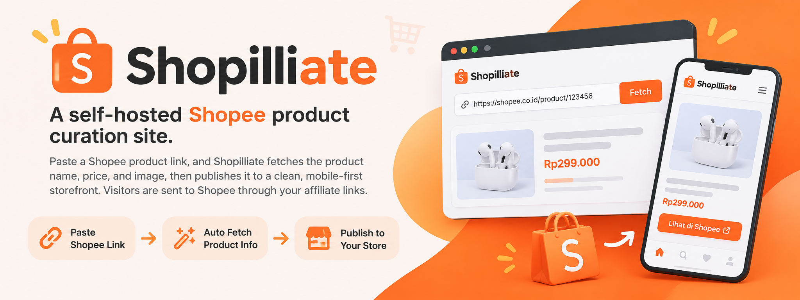

# Shopilliate

Situs kurasi produk Shopee yang dapat Anda host sendiri. Tempelkan link produk Shopee, lalu Shopilliate mengambil nama, harga, dan gambar produk, kemudian menampilkannya di etalase yang bersih dan ramah mobile. Pengunjung diarahkan ke Shopee melalui link afiliasi Anda.

Semua berjalan pada satu Cloudflare Worker: API (`/api/*`), gambar (`/img/*`), dan aplikasi React satu halaman.

[English](../README.md)

**Demo:** [linkby.lukmanbagus.com](https://linkby.lukmanbagus.com) — contoh situs yang dibangun dengan Shopilliate.

## Fitur

- Tambah produk hanya dengan menempelkan link Shopee. Data diambil melalui Shopee Affiliate API resmi bila dikonfigurasi, dengan fallback halaman publik dan formulir manual sebagai pilihan terakhir.
- Etalase publik dengan kategori, subkategori, pencarian, pengurutan, badge TOP, dan pencatatan klik.
- Panel admin dengan dashboard, pengelolaan produk dan kategori, sinkron ulang, unggah gambar, dan pengaturan situs.
- Gambar disimpan di Cloudflare R2 dan disajikan dari domain Anda sendiri.
- Wizard setup pertama dengan pembuatan akun admin yang atomik dan `SETUP_TOKEN` opsional.
- Bahasa Inggris sebagai default, dengan Bahasa Indonesia tersedia di Pengaturan.
- Skema database dibuat otomatis: tidak perlu migrasi manual.

## Stack

- Cloudflare Workers + Hono (TypeScript)
- Cloudflare D1 (SQLite)
- Penyimpanan objek Cloudflare R2
- React + Vite + Tailwind CSS + React Router
- Zod untuk validasi bersama
- Hash password PBKDF2-SHA256 (100.000 iterasi)

## Prasyarat

- Akun Cloudflare (paket gratis cukup untuk situs kecil).
- Node.js 20.19+ dan npm untuk setup satu perintah serta pengembangan lokal.

## Deploy

### Opsi 1 — Tombol Deploy to Cloudflare (disarankan)

Ganti `USERNAME` dengan username GitHub Anda:

```md
[](https://deploy.workers.cloudflare.com/?url=https://github.com/USERNAME/shopilliate)
```

1. Klik tombol dan masuk ke Cloudflare.
2. Cloudflare menyalin repo ke akun GitHub/GitLab Anda dan menampilkan formulir deployment.
3. Biarkan build command `npm run build`. Opsional, isi secret `SETUP_TOKEN` untuk mengunci halaman setup.
4. Deploy. Worker, database D1, dan bucket R2 dibuat dan dihubungkan secara otomatis.
5. Segera buka URL Worker dan selesaikan halaman `/setup`.

> `wrangler.jsonc` sengaja tidak menyertakan ID resource agar Cloudflare dapat membuat D1 dan R2 untuk akun Anda.

### Opsi 2 — Setup satu perintah

```bash
npm install
npm run setup
```

Setup bersifat interaktif. Pertama, Anda memilih cara menyiapkan resource Cloudflare:

- **Buat resource baru** — membuat database D1 `shopilliate-db` dan bucket R2 `shopilliate-images` bila belum ada.
- **Gunakan deployment yang sudah ada** — menampilkan daftar database D1 dan bucket R2 di akun Anda, meminta Anda memilih, lalu menanyakan nama Worker agar deploy memperbarui Worker yang sudah ada.

Setelah itu skrip menulis nama resource dan ID database ke `wrangler.jsonc`, membangun frontend, mendeploy Worker, dan mencetak URL hasil deploy.

Untuk otomatisasi tanpa interaksi:

```bash
npm run setup -- --new
npm run setup -- --existing --d1 shopilliate-db --r2 shopilliate-images --worker shopilliate
```

Untuk melihat bantuan dan opsi:

```bash
npm run setup -- --help
```

Untuk melindungi halaman setup dengan secret:

```bash
npx wrangler secret put SETUP_TOKEN
```

### Opsi 3 — Pengembangan lokal

```bash
npm install
cp .dev.vars.example .dev.vars
npm run dev
```

Buka `http://localhost:5173`. Vite menyajikan UI dan mem-proxy `/api` serta `/img` ke `wrangler dev` pada port 8787. Data D1 dan R2 lokal disimpan di `.wrangler/`. Skema database dibuat otomatis pada permintaan pertama.

## Domain kustom

1. Pastikan domain aktif di akun Cloudflare yang sama.
2. Buka **Workers & Pages → Worker Anda → Settings → Domains & Routes → Add → Custom domain**.
3. Masukkan domain atau subdomain lalu simpan. TLS dibuat otomatis.

## Konfigurasi

Semua pengaturan tersedia di **Admin → Pengaturan** setelah setup.

### Kredensial Shopee Affiliate (opsional)

Isi **App ID** dan **App Secret** Shopee Affiliate Anda untuk memakai API resmi dalam pengambilan data produk. Secret disimpan di sisi server dan tidak pernah dikirim kembali ke browser. Tanpa kredensial, Shopilliate memakai halaman produk publik, lalu formulir manual.

### Bahasa

Antarmuka default memakai **English**. Ganti ke **Bahasa Indonesia** di **Admin → Pengaturan → Bahasa**. Pilihan berlaku untuk etalase publik, panel admin, halaman login, dan setup, serta pesan validasi API mengikuti bahasa aktif.

### Pengaturan etalase

Nama situs, teks banner atas, judul dan deskripsi hero, pernyataan afiliasi, kategori, subkategori, dan detail produk (termasuk badge TOP) semuanya dapat diubah dari panel admin.

## Atur ulang password yang lupa

```bash
npm run reset-password
```

Skrip meminta password baru tanpa menampilkannya, menyimpan hanya hash PBKDF2 baru, dan mengeluarkan semua sesi lama. Untuk data lokal:

```bash
npm run reset-password -- --local
```

## Memperbarui

```bash
git pull
npm install
npm run publish
```

`npm run publish` membangun frontend dan mendeploy Worker. Jika memakai tombol Deploy to Cloudflare atau Workers Builds, deploy ulang dari dashboard. Skema database diperbarui otomatis; tidak ada migrasi yang perlu dijalankan.

## Keamanan

- Password di-hash dengan PBKDF2-SHA256 dan salt acak 16 byte. Password asli tidak pernah disimpan atau dicatat.
- Sesi memakai token acak 32 byte; hanya hash SHA-256 yang disimpan di D1. Cookie bersifat `HttpOnly`, `Secure`, `SameSite=Lax`, dan berlaku 14 hari.
- Setup pertama bersifat atomik. Setelah instalasi, `/setup` dan `POST /api/setup` ditolak.
- Percobaan login dibatasi 5 kegagalan per 15 menit per IP.
- Permintaan non-GET wajib memakai content type JSON dan header `Origin` yang cocok (unggah berkas adalah satu-satunya pengecualian multipart).
- Header keamanan mencakup Content-Security-Policy, `X-Content-Type-Options`, `Referrer-Policy`, dan `X-Frame-Options`.
- Link Shopee divalidasi terhadap allowlist dengan batas redirect dan timeout. Gambar hanya diunduh dari CDN Shopee.
- Unggahan dibatasi 5 MB dan divalidasi berdasarkan isi berkas, bukan hanya ekstensi.
- Secret API Shopee disimpan di sisi server dan tidak pernah dikembalikan ke browser.

**Risiko pengambilalihan setup:** siapa pun yang membuka URL yang baru di-deploy sebelum Anda membuat akun admin. Isi `SETUP_TOKEN` saat deploy dan segera buka URL.

## Penafian

Shopilliate adalah proyek independen dan tidak terafiliasi dengan, didukung oleh, atau disponsori oleh Shopee. Shopee dan merek-mereknya adalah milik pemegang hak masing-masing. Seluruh pembelian dan transaksi terjadi di Shopee dan tunduk pada ketentuan serta kebijakan Shopee. Data produk dan harga dapat berubah sewaktu-waktu di Shopee.

## Struktur repo

```
wrangler.jsonc            Konfigurasi Cloudflare Worker, D1, dan R2
.dev.vars.example         SETUP_TOKEN opsional untuk pengembangan lokal
migrations/               Skema SQL rujukan (dibuat otomatis saat runtime)
scripts/                  Setup interaktif dan reset password
src/shared/               Skema validasi, tipe bersama, dan terjemahan
src/worker/               Aplikasi Hono, rute, dan library server
src/web/                  Etalase React dan panel admin
tests/                    Uji unit
```

## Script

| Perintah | Deskripsi |
| --- | --- |
| `npm run dev` | Jalankan Vite dan Worker secara lokal |
| `npm run build` | Bangun frontend untuk produksi |
| `npm run deploy` | Deploy Worker dengan Wrangler |
| `npm run publish` | Bangun dan deploy dalam satu langkah |
| `npm run setup` | Setup Cloudflare interaktif dan deploy (resource baru atau yang sudah ada) |
| `npm run reset-password` | Atur ulang password admin |
| `npm test` | Jalankan uji unit |
| `npm run typecheck` | Periksa tipe Worker dan aplikasi web |

## Pengujian

```bash
npm test
npm run typecheck
npm run build
```

Cakupan uji meliputi hash password, guard setup, ekstraksi URL Shopee dan validasi domain (perlindungan SSRF), serta lapisan terjemahan.
